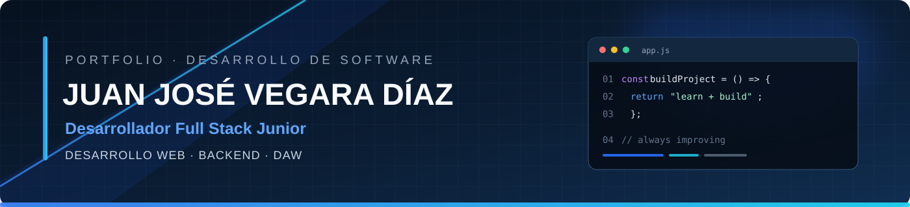

 

  

 

---

## 👨‍💻 Sobre mí

Soy **Juan José**, estudiante de **Desarrollo de Aplicaciones Web (DAW)** y **desarrollador Full Stack Junior** en formación. Me gusta construir aplicaciones útiles, cuidar las buenas prácticas y mejorar a base de proyectos propios.

- 🔭 Centrado en **desarrollo web**, **programación backend** y **bases de datos**
- 🌱 Profundizando en **Spring Boot**, **Laravel** y **React**
- 🐳 Aprendiendo a desplegar y empaquetar aplicaciones con **Docker**
- 🤝 Vengo de la **hostelería**: organización, responsabilidad y trabajo en equipo bajo presión
- 🎯 Busco proyectos reales donde aprender, colaborar y aportar valor

---

## 🛠️ Stack tecnológico

### Backend

  

### Frontend

  

### Bases de datos

  

### Herramientas y DevOps

  

<b>📋 Ver detalle por área</b>

 

| Área | Tecnologías |
| --- | --- |
| **Backend** | Java, Spring Boot, PHP, Laravel, Node.js |
| **Frontend** | HTML, CSS, JavaScript, React |
| **Bases de datos** | SQL, MySQL, MariaDB |
| **Herramientas** | Git, GitHub, Docker, Maven, Visual Studio Code |

---

## 🚀 Proyectos destacados

<table>
  <tr>
    <td width="50%" valign="top">

### 🎮 CINDER SIGNAL: NIGHT DISPATCH

Videojuego indie de PC de **supervivencia táctica**, centrado en la linterna, la exploración y la toma de decisiones.

**Electron · JavaScript · HTML · CSS**

</td>
    <td width="50%" valign="top">

### ⚔️ Bleach Shinigami — POO en Java

Ejercicio de **programación orientada a objetos** que practica clases abstractas, herencia, composición y polimorfismo.

**Java · Maven · POO**

</td>
  </tr>
  <tr>
    <td colspan="2" valign="top">

### 📚 Skillverse &nbsp; 

Plataforma web de **aprendizaje gamificado**. Proyecto personal en construcción; añadiré el enlace al repositorio cuando esté listo para compartir.

</td>
  </tr>
</table>

---

## 📊 Actividad en GitHub

 

---

## 🎯 Objetivo profesional

Seguir creciendo como **desarrollador Full Stack Junior**, consolidar mis conocimientos de backend y bases de datos, y sumarme a un equipo donde aprender, colaborar y aportar valor desde el primer día.

---

## 📫 Contacto

---

*Aprender, construir y mejorar proyecto a proyecto.*

